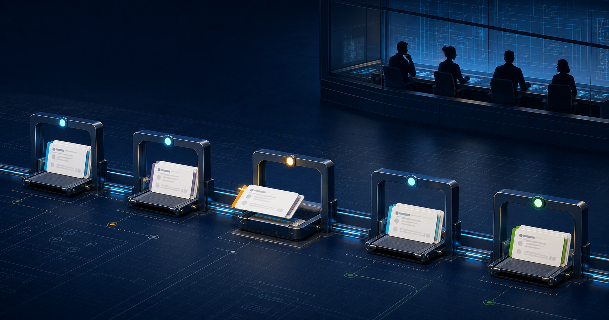

# Agile Iteration Method (AIM) 4.0


AIM is a delivery method for AI-assisted software work. Start with an intent. PO discovers Epics and User Stories, then AIM plans a prioritized selection, builds it, reviews it and validates every Story before user acceptance. **Better software. From the same AI:** we tested GPT-6 Luna building the same web app with and without AIM, first at initial delivery and again after the same major upgrade. AIM 3.2 delivered the stronger product in both tests: **93.5 versus 49.8**, then **93.5 versus 62.8**, out of 100 against predefined criteria. [See the case and public evidence](docs/features/aim-3.2-enigma-case.md).

Switch between Codex, Claude Code, and GitHub Copilot while keeping your project knowledge and saved AIM work. Discuss ideas with your repository before starting implementation. Each tool needs AIM and access to the same current repository and saved state.

## Install

Install the complete, self-contained AIM Agent Skill through the open skills ecosystem:

[](https://skills.sh/joneri/agile-iteration-method)

```bash
npx skills add joneri/agile-iteration-method \
  --skill agile-iteration-method
```

This is full AIM, not AIM Lite. The package is generated from the same canonical workflow, adapter, installer, and schema sources as the adaptive AIM distribution. It does not require a separate AIM npm publication.

Target one supported agent explicitly when needed:

```bash
# Codex
npx skills add joneri/agile-iteration-method \
  --skill agile-iteration-method --agent codex --yes

# GitHub Copilot
npx skills add joneri/agile-iteration-method \
  --skill agile-iteration-method --agent github-copilot --yes

# Claude Code
npx skills add joneri/agile-iteration-method \
  --skill agile-iteration-method --agent claude-code --yes
```

Update an installed public skill with:

```bash
npx skills update agile-iteration-method --yes
```

The adaptive AIM installer remains available when you want reviewed repository calibration, native project specialists, or a broader supplier-specific footprint. Clone the public source so you can inspect exactly what will run:

```bash
git clone --depth 1 https://github.com/joneri/agile-iteration-method.git aim-source
cd aim-source
python3 scripts/aim_install.py --dry-run
```

Review the source and preview, then rerun with `--apply` only when the plan is correct. The installer asks for a repository and the adapters you use. Native project specialists can also be refreshed later through `/aim configure-agents` from `aim.roles.yaml`.

Already using AIM? Run:

```text
/aim upgrade
```

## Start

First verify the repository knowledge AIM will reuse:

```text
/aim calibrate-repo
```

Record a durable project rule when AIM should remember it on later runs:

```text
/aim remember-repo habits "Keep user-facing language direct and calm."
```

Turn completed AIM work into reviewable knowledge candidates:

```text
/aim reflect
/aim reflect-all
```

Reflect verifies historical lessons against current repository evidence, preserves provenance and contradictions, and keeps promotion under your control. It finishes by saying whether action is recommended and gives one concrete next step—or states that nothing needs to be remembered or forgotten. `reflect-all` previews its local project inventory before analyzing the selected set and never modifies discovered repositories.

Then start with an outcome, not a task list:

```text
/aim start "Make checkout recovery clear and reliable when payment confirmation is delayed"
```

Use `/aim help` when you want the next useful action. The same command family also covers continue, status, validation, configuration, upgrade, memory, execution mode, cost depth, and replanning.

## From intent to accepted User Stories

```text
Intent → Epics → User Stories → delivery selection → working increment
```

Describe what you want to achieve. PO discovers Epics and owns Stories, criteria and priority. TDO refines with PO and plans a selection that can include Stories from different Epics.

Run `/aim ui` to follow **User Stories as moving cards**, with Epic context and individual evidence. A Sprint is an optional timebox. An increment is the working result of delivered Stories.

Existing Epic/Increment work keeps its original state and approvals in Delivery control. Nothing is automatically migrated or relabelled. See [the requirements model](docs/workflow/user-stories.md).

## How AIM works

```text
PO → TDO → Dev → Reviewer → TDO → PO
```

- **PO** owns intent, Epic outcomes, Stories, criteria and priority.
- **TDO** refines with PO, plans the Story selection and validates delivery.
- **Dev** implements the approved selection.
- **Reviewer** checks current behavior, regressions and Story evidence.

Gate A confirms direction and requirements. Gate B approves the selection and plan. Gate E accepts verified Stories. Epic closure is a separate decision supported by whole-outcome evidence.

`Strict` asks for plan approval and acceptance. `Auto` progresses within existing authority, returning for changed scope, risk or final acceptance.

## Repository-aware, not repository-heavy

| Surface | Purpose |
| --- | --- |
| `docs/workflow/agile-iteration-method.md` | canonical AIM method |
| `aim.profile.yaml` | reusable repository knowledge |
| `aim.roles.yaml` | project-specific PO, TDO, Dev, and Reviewer expertise |
| `.aim/` | active local runtime state and review evidence |

The standard installation adds the selected supplier skills and native project specialists. It never needs to create `AGENTS.md` or `CLAUDE.md`.

## Native adapters

| Platform | AIM skill | Project specialists |
| --- | --- | --- |
| Codex | `~/.agents/skills/agile-iteration-method/` | `.codex/agents/aim-*.toml` |
| Claude Code | `.claude/skills/aim/` | `.claude/agents/aim-*.md` |
| GitHub Copilot | `.github/skills/aim/` | `.github/agents/aim-*.agent.md` |

All adapters use the same AIM roles, gates, state ownership, and `/aim` command semantics. Supplier-specific files define how each project specialist works.

## Smarter output from the start

AIM applies **audience-context integrity** to everything it generates: write the intended current meaning for the reader, and keep private conversations, rejected drafts, prompts, AI mistakes, and review feedback out of product copy, UI, code comments, and documentation. Changelogs and other intentionally historical artifacts keep the history their audience actually needs.

## What is new in v4.0.0

**User needs have their own identity and lifecycle.** AIM 4.0 introduces a PO-owned product backlog and Story board, separating requirements from plans and delivered increments.

- **Intent-led start:** describe a problem; PO discovers one or more Epics.
- **Explicit Stories:** preserve each user's need, benefit, priority and criteria.
- **Cross-Epic selection:** deliver the highest-value ready Stories together.
- **Evidence per Story:** review, validation and acceptance remain traceable.
- **Separate Epic closure:** a completed delivery does not silently close a goal.
- **Preserved history:** existing Epic/Increment runs keep their original meaning.

See the [Story contract](docs/workflow/user-stories.md). The measurements below describe the earlier AIM 3.2 study; they are not a benchmark of 4.0.

**The advantage held through both tests:** at initial delivery, Luna + AIM solved **9/9 new search challenges versus 0/9** and passed **123/123 machine checks versus 1/123**. After the upgrade, it solved **8/8 versus 1/8**, while both passed **243/243 checks**. Every checked AIM result after the upgrade was valid (32/32); Luna alone returned one false match. The same complete upgraded search ran **55.7× faster** (0.242 versus 13.477 s, application runtime). [Both tests, method and evidence](docs/features/aim-3.2-enigma-case.md) · [Original test in detail](docs/features/aim-3.2-enigma-m3-case.md) · [Earlier resource-efficiency results](docs/features/aim-3.1-evaluation.md).



See the [AIM UI Beta guide](docs/product/aim-ui.md), or launch it with `/aim ui`.
AIM Reflect still **goes beyond memory cleanup for repository work** through verified provenance and user-owned promotion. The preserved legacy runtime contract remains 2.0; the new product-backlog schema is 1.0. Product, runtime, installer and schema versions stay separate.

## Safety

- one main AIM thread owns the product backlog, legacy state and gate transitions
- native specialists never accept work or create parallel AIM runtimes
- existing files are collision-protected
- apply is rollback-protected and idempotent
- unavailable native delegation falls back to the same sequential role loop
- tags, releases, deploys, and other external changes still need explicit scope

## Documentation

- [Engineering delivery and role skills](docs/workflow/engineering-delivery.md) · [Enigma comparison analysis and measured improvements](docs/features/engineering-reset-analysis.md)
- [Feature guide](docs/product/features.md) · [AIM UI control room](docs/product/aim-ui.md) · [First-time journey](docs/product/getting-started.md)
- [Platforms and project specialists](docs/product/platforms-and-adoption.md) · [Install and upgrade](docs/workflow/install-aim-2.0.md) · [Canonical AIM method](docs/workflow/agile-iteration-method.md)
- [AIM Reflect](docs/workflow/reflection.md) · [Troubleshooting](docs/workflow/troubleshoot-aim-2.0.md) · [Release and publication](docs/workflow/release-publication-model.md) · [Public Agent Skill distribution](docs/workflow/version-and-installation.md)

Current product version: **v4.0.0**. See [CHANGELOG.md](CHANGELOG.md). Documentation is licensed under [CC BY 4.0](LICENSE).
