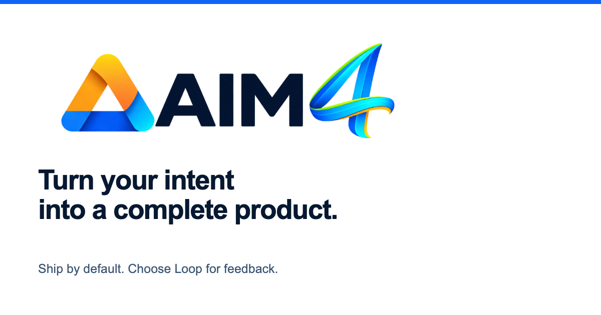

# Agile Iteration Method (AIM)



AIM turns your intent into a complete, verified product. **Ship is the default**;
choose **Loop** for useful Done Increments with recurring owner feedback. Use it with Codex, Claude Code or GitHub Copilot.

Follow the product in **AIM UI**: inspect Stories, dependencies, blockers and evidence.
**AIM 4.8 Native Graph engineering** builds a small work graph or validates your
own. Durable orchestration connects original goals, proof and continuation
decisions across sessions. Decisions stay with the designated owner.

## Install

Install the complete, self-contained AIM Agent Skill through the open skills ecosystem:

[](https://skills.sh/joneri/agile-iteration-method)

```bash
npx skills add joneri/agile-iteration-method --skill agile-iteration-method
```

Select your agent and project in the installer. Then tell the agent what you want:

```text
/aim start "Make checkout recovery clear when payment confirmation is delayed"
```

The complete skill works without this source checkout. Node.js/npm runs installation;
Python 3 runs local helpers. You can also copy [the agent setup instructions](github-pages/assets/aim-install-agent.txt).

Target one supported agent explicitly when needed:

```bash
# Codex
npx skills add joneri/agile-iteration-method --skill agile-iteration-method --agent codex --yes

# GitHub Copilot
npx skills add joneri/agile-iteration-method --skill agile-iteration-method --agent github-copilot --yes

# Claude Code
npx skills add joneri/agile-iteration-method --skill agile-iteration-method --agent claude-code --yes
```

Update an installed public skill with:

```bash
npx skills update agile-iteration-method --yes
```

The adaptive AIM installer remains available when you want reviewed repository calibration, native project specialists, or a broader supplier-specific footprint. Clone the public source so you can inspect exactly what will run:

```bash
git clone --depth 1 https://github.com/joneri/agile-iteration-method.git aim-source
cd aim-source
python3 scripts/aim_install.py --dry-run
```

Review the source and preview, then rerun with `--apply` only when the plan is correct. The installer asks for a repository and the adapters you use. Native project specialists can also be refreshed later through `/aim configure-agents` from `aim.roles.yaml`.

Already using AIM? Run:

```text
/aim upgrade
```

## Start

Give AIM the desired outcome:

```text
/aim start "<desired outcome>"
```

Within that start, AIM prepares applicable missing or stale knowledge, agents and available skills within the existing write footprint.
Empty repos use provisional knowledge and bundled skills; use `/aim calibrate-repo` or `/aim configure-agents` for a later refresh.

Record a durable project rule when AIM should remember it on later runs:

```text
/aim remember-repo habits "Keep user-facing language direct and calm."
```

Learning is part of ordinary delivery: AIM recalls bounded shared advice while planning, reviewing and diagnosing failures, and shares evidence-linked reusable lessons. No manual reflection command, repository inventory or mandatory report is required. The old `reflect` and `reflect-all` names are retired compatibility aliases. A concrete stale fact, contradiction or suspected missing lesson can justify a targeted authorized source audit. Maintained project knowledge keeps its own sources and reviewed change path.

Use `/aim help` when you want the next useful action. The same command family also covers continue, status, validation, configuration, upgrade, memory, execution mode, cost depth, and replanning.

## Ship by default. Loop when feedback should lead.

**Ship** completes the agreed product outcome before final acceptance. Choose **Loop** for useful Done Increments and recurring owner feedback.
Both include independent review and verification. Strict/Auto controls approvals separately.

Use **Graph engineering** to let your agent coordinate outcome ownership, delivery dependencies, evidence and feedback:

```text
Use AIM in Strict Loop. Act as my product owner and delegate delivery. Assess verified increments within [outcome, allowed decisions and resource limit].
```

Start with your goal; AIM chooses a small default graph or validates your own. Native orchestration binds actual sessions and retains campaign progress across restarts. See [the Native contract and supported enforcement paths](docs/workflow/native-orchestration.md). Existing approved plans retain their behavior.

Agent-owner decisions require explicit human delegation; existing work keeps its frozen policy. See [delivery and owner contracts](docs/workflow/user-stories.md).

## From intent to accepted User Stories

```text
Intent → Epics → User Stories → delivery selection → working increment
```

Describe what you want to achieve, or provide detailed requirements. PO owns Epic outcomes and product priority. TDO creates and owns Stories and criteria, then plans a coherent increment that can include Stories from different Epics.

Run `/aim ui` to follow **User Stories as moving cards**, with Epic context and individual evidence. A Sprint is an optional timebox. An increment is the working result of delivered Stories.

Use `/aim graph` or the UI's **Graph** tab to see what can start, what blocks the delivery,
and which proof needs updating. [How AIM Graph works](docs/workflow/adaptive-execution.md#aim-graph).

Existing Epic/Increment work keeps its original state and approvals in Delivery control. Nothing is automatically migrated or relabelled. See [the requirements model](docs/workflow/user-stories.md).

## How AIM works

```text
PO → TDO → Dev → Reviewer → TDO → PO
```

- **PO** owns intent, Epic outcomes and product priority.
- **TDO** owns Stories and criteria, plans the coherent increment and validates delivery.
- **Dev** implements the approved selection.
- **Reviewer** checks current behavior, regressions and Story evidence.

Gate A confirms direction and requirements. Gate B approves the selection and plan. Gate E accepts verified Stories. Epic closure is a separate decision supported by whole-outcome evidence.

`Strict` asks the designated owner for plan approval and acceptance. `Auto` progresses within existing authority, returning for changed scope, risk or final acceptance. Agent-owner decisions require explicit human delegation and current evidence.

## Repository-aware, not repository-heavy

| Surface | Purpose |
| --- | --- |
| `docs/workflow/agile-iteration-method.md` | canonical AIM method |
| `aim.profile.yaml` | reusable repository knowledge |
| `aim.roles.yaml` | project-specific PO, TDO, Dev, and Reviewer expertise |
| `.aim/` | active local runtime state and review evidence |

The standard installation adds the selected supplier skills and native project specialists. It never needs to create `AGENTS.md` or `CLAUDE.md`.

## Native adapters

| Platform | AIM skill | Project specialists |
| --- | --- | --- |
| Codex | `~/.agents/skills/agile-iteration-method/` | `.codex/agents/aim-*.toml` |
| Claude Code | `.claude/skills/aim/` | `.claude/agents/aim-*.md` |
| GitHub Copilot | `.github/skills/aim/` | `.github/agents/aim-*.agent.md` |

All adapters use the same AIM roles, gates, state ownership, and `/aim` command semantics. Supplier-specific files define how each project specialist works.

## Smarter output from the start

AIM applies **audience-context integrity** to everything it generates: write the intended current meaning for the reader, and keep private conversations, rejected drafts, prompts, AI mistakes, and review feedback out of product copy, UI, code comments, and documentation. Changelogs and other intentionally historical artifacts keep the history their audience actually needs.

## What is new

- **Native Graph engineering.** Choose a small default or supply a graph. Bind actual coordinating sessions and retain original campaign progress, priorities and recoverable source checkpoints across restarts.
- **Quality and independent review.** Measure the first working core, challenge material assumptions with a separate reviewer, and verify integrated user journeys with source-bound raw proof.
- **Reusable project knowledge.** Keep user-route maps and verification recipes, recall shared lessons and share verified reusable corrections during ordinary delivery. Reuse compact receipts and unchanged evidence.
- **Focused tools.** [Discover tools when needed and filter large MCP results](docs/workflow/tool-efficiency.md), keeping sources, counterevidence and permissions intact. Native support and actual savings depend on the host and task.

These capabilities depend on agents using them and the project's verification coverage. See the [feature guide](docs/product/features.md) and [changelog](CHANGELOG.md).

## What the Enigma results show

The latest completed product assessment scored **96.5/100**, against the historical reference's **93.5/100**. The simulator passed **123/123** reference vectors, all **9/9** positive search cases passed, and all **114/114** returned candidates were independently validated. This is one assisted run with GPT-6 Luna High; the actual tested build and every retained earlier result are identified in the [Enigma evaluation](docs/features/aim-enigma-evaluation.md).

The product score does not establish general superiority, lower cost or completion of all method goals. The run missed one internal latency target and did not finish its native delivery. Both whole-workflow administration reduction targets remain unproved. The [historical paired study](docs/features/aim-3.2-enigma-case.md) remains available with its original evidence.

## Versions and compatibility

See [VERSION](VERSION) for the current release and [CHANGELOG.md](CHANGELOG.md) for changes.
Product versions and runtime/schema contracts are separate. Upgrades preserve active work and accepted evidence.
